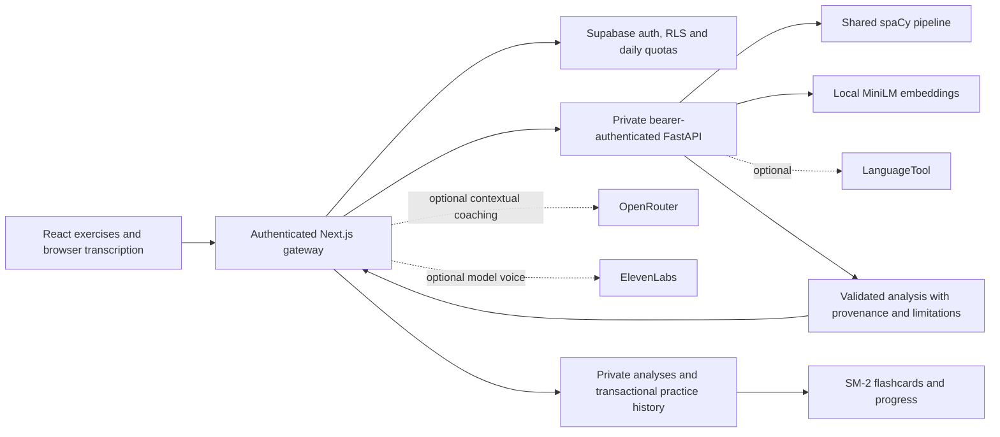

# FluentFive NLP architecture and methodology

## Problem and scope

Learners need specific feedback on their own English, opportunities to reuse useful expressions, and a dependable record of practice. The platform measures observable text and elapsed session time, offers optional contextual AI advice, and preserves the existing five-activity experience. It does not certify CEFR proficiency, diagnose speech disorders, or measure pronunciation acoustics.

## Before and after

Before: browser pages queried Supabase and independently called LanguageTool, Wikipedia and an OpenRouter route. The cycle had no completion persistence, dashboard values were static, and some reward writes were unawaited.

After:

The browser never receives the private NLP key or provider keys. `src/app/api/nlp/analyze/route.ts` authenticates, bounds input, checks an exact request hash scoped to the user, reserves a database quota, calls Python, validates the response and stores it before reporting success. Completion and phrase selection are a separate transaction so the learner chooses what to remember. All generated text is rendered as React text.

## Algorithms and purposes

| Technique | Implementation | Purpose / limitation |
|---|---|---|
| Tokenization and segmentation | spaCy English tokenizer/parser or explicitly marked blank tokenizer/sentencizer fallback | Preserve offsets and punctuation. Statistical segmentation can be imperfect on unpunctuated transcripts. |
| POS and lemmatization | en_core_web_sm trained tagger, morphologizer/lemmatizer pipeline | Group inflections; never infer universal grammar correctness from POS alone. |
| NER | Trained spaCy entities | Identify named concepts in reading; unavailable without the trained pipeline. |
| Grammar | Conservative learner rules plus optional LanguageTool | Tense cues, subject agreement, selected articles/prepositions/word forms/spelling; source, category, exact spans and explanations. Coverage is limited without LanguageTool. |
| Correction | Non-overlapping span edits applied right-to-left | Preserve unrelated content and punctuation. A suggestion is not an automatic edit to the learner's draft. |
| Vocabulary frequency | Case-folded content lemmas and stop-word handling | Detect repeated content words; repetition is not always an error. |
| Lexical diversity | TTR and 50-word MATTR | MATTR is withheld for fewer than 50 words; both are descriptive, task/length-sensitive signals. |
| Complexity | Mean word length, long-word fraction | Descriptive features, not a ranking of good English or a CEFR classifier. |
| Phrase extraction | Dependency noun phrases, verb-particle/adposition pairs, attested reusable expressions | Every extracted span occurs in the passage; candidate educational value is imperfect. No invented dictionary definition. |
| Contextual vocabulary | Small context-specific pattern set; optional OpenRouter usage explanations | Suggestions are anchored to actual context. No arbitrary difficult-synonym substitution. |
| Semantic similarity | Pinned all-MiniLM-L6-v2 unit sentence embeddings, cosine similarity | Captures paraphrase/topic relationships, not truth or correctness. Local-only inference; 256-token truncation disclosed. |
| Coherence proxy | Mean adjacent-sentence cosine, at most first 30 sentences | Measures semantic continuity, not logic. Distinct legitimate topics can reduce similarity. |
| Phrase matching | Unicode word-boundary exact matching plus semantic hints | Semantic hints never count as exact target usage. |
| Duplicate sentences | Case-folded exact comparisons and embedding cosine >= .92 | Threshold is provisional, not trained on learner data. |
| Speaking | Recognized words / elapsed session minutes, marker counts, repeated sequences, correction markers, dependency-based completeness heuristic | No articulation rate, acoustic pauses, phonemes, stress or pronunciation score. Discourse markers may be meaningful. |
| Shadowing alignment | Levenshtein dynamic programming, Unicode normalization, case/punctuation-insensitive lexical tokens | Explicit substitutions/deletions/insertions; recognizer errors and paraphrases can increase WER. |
| Reading difficulty | Flesch-style reading ease with heuristic syllables | Text difficulty only, not learner proficiency; syllables and unfamiliar domain vocabulary limit validity. |
| Reading questions | Main idea/detail/conditional causal question with extractive anchors | No event/causal question is invented when the passage does not support it. Semantic grading reports relevance rather than correctness. |
| Personalization | Transparent category and usage counts over completed analyses | Recommend only after evidence from at least two analyses. No trained recommendation model or invented accuracy. |
| Review | Existing SM-2 formula, now executed transactionally in PostgreSQL | Self-reported recall quality; not externally measured retention. |

## Scores

Practice score version: `practice-v1`. Engine/schema version: `nlp-v1`. Every result records spaCy and pipeline versions, embedding model/revision, detector version and scoring components.

- Grammar component: `max(0, 100 - 8 * detected_errors_per_100_words)`.
- Filler component: `max(0, 100 - 250 * possible_fillers / word_count)`.
- Pace component: `max(0, 100 - 1.2 * max(0,80-WPM) - .7 * max(0,WPM-180))`.
- Speaking/cycle weights: grammar `.6`, fillers `.3`, pace `.1`; omit unavailable pace and renormalize remaining weights.
- Writing uses the detected-grammar component only. Structure, register and vocabulary suggestions remain separate.
- Overall score is withheld below 10 words and for reading/semantic/grammar/vocabulary/shadow modes. Lexical shadowing agreement is a different measure.
- `WER=(substitutions+deletions+insertions)/reference_words`; it can exceed 1. Lexical agreement is `100*max(0,1-WER)`. Completion excludes deletions, independent of substitutions.
- Semantic labels use provisional cosine thresholds: >= `.35` likely related, < `.15` possibly off topic, otherwise uncertain. Similarity never contributes to the overall practice score.

These weights and ranges are product heuristics, not calibrated proficiency norms. Grammar scores depend strongly on detector coverage. Compare only similar tasks, transcript lengths and detector configurations. No meaning is silently assigned to unmeasured acoustic fields; legacy AI contracts now return null/empty values for those fields.

## Persistence and learning history

Migration 003 adds `nlp_analyses`, `practice_sessions`, `flashcard_reviews`, `api_usage`, chunk identity keys and quiz attempt identities. Existing daily `sessions`, profiles, drafts, quiz results and chunks remain.

`complete_practice` locks the user's profile, checks the attempt UUID and analysis ownership, saves selected phrases, inserts a detailed attempt, upserts daily completion, updates UTC streak/XP/daily stats, and saves a writing rewrite in one transaction. Duplicate retry cannot add rewards. Each daily activity earns XP once; later attempts remain in history. Review awards 10 XP once per due card/day and applies the original SM-2 schedule. Quiz rewards are capped to the first quiz attempt per UTC day; quiz scores remain practice self-reports, not certified exams. `save_learning_chunks` preserves old duplicates but prevents new duplicates through normalized identity plus profile locking. No historical rows are deleted by migration.

Dashboard statistics come from storage. Progress uses actual earned XP, per-session metrics, self-reported flashcard recall, phrase usage and recurrent error categories. Detailed history is bounded to the newest 250 attempts and trends/personalization to the newest 100 distinct completed analyses. Charts retain prior daily activity even when it predates the migration. New analyses alone do not count as completed practice.

## Privacy and operational limits

Bearer authentication protects private service endpoints; Supabase RLS isolates learner-owned history. Private tables have no anonymous read policy. SQL functions use an empty search path and explicit `auth.uid()` checks; public execution is revoked. Browser clients cannot edit profile XP. User deletion of analysis history is explicit and separate from completion payloads/drafts/flashcards.

Raw transcripts/audio are not logged by the application. Model vector caches use input hashes as keys and are bounded in memory. Local shadowing blobs are revoked on cleanup. Browser recognition, optional public LanguageTool, OpenRouter and ElevenLabs have their own processing policies; the account page explains where content goes. Keep real secrets outside Git and use a private network/TLS between deployed services. The app does not impose an automatic deletion schedule; operators must choose and document one before onboarding users.

## Evaluation and next research work

`nlp-service/evaluation` contains original CC0 development examples. The harness measures exact error-span precision/recall, exact corrected-sentence match, WER correctness, labeled semantic relationship accuracy, schema round-trip reliability and observed latency. Missing embeddings produce null semantic accuracy, never fabricated results. Current examples are tiny and overlap development requirements; perfect results on them are not evidence of broad accuracy. Tests additionally cover correct sentences, Unicode offsets, failures and input bounds.

For defensible generalization, add a licensed held-out learner corpus, independent error annotation, diverse accents/ASR noise, response-length stratification, inter-rater agreement and confidence intervals. Calibrate semantic thresholds on task-specific labels and examine counterexamples/negation. Acoustic pronunciation needs a validated audio model/service and consent/retention design; no substitute is claimed here.

Primary method documentation: [spaCy pipelines](https://spacy.io/usage/processing-pipelines), [spaCy English model](https://spacy.io/models/en#en_core_web_sm), [Sentence Transformers similarity](https://www.sbert.net/docs/sentence_transformer/usage/semantic_textual_similarity.html), [Sentence-BERT paper](https://arxiv.org/abs/1908.10084), [LanguageTool HTTP API](https://languagetool.org/http-api/).
